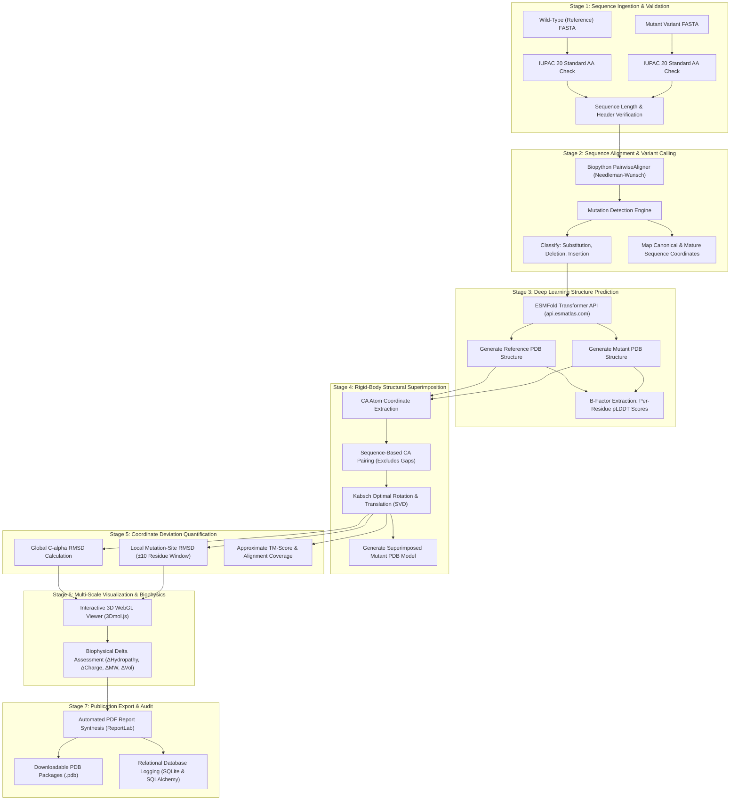

# Automated *In Silico* Protein Mutation Analysis & Tertiary Structure Prediction Suite
## End-to-End Scientific Workflow, Technical Architecture, and Presentation Guide

---

## 1. Executive Summary

This application is an automated, end-to-end computational bioinformatics platform designed to evaluate the structural, biophysical, and spatial consequences of non-synonymous single nucleotide variants (missense mutations) and in-frame indels on protein tertiary structures.

The system combines:
1. **Sequence-level genomics/proteomics** (IUPAC validation, dynamic programming global alignment, mutation calling).
2. **State-of-the-art deep learning structural biology** (Meta AI's ESMFold v1 transformer language model).
3. **Rigid-body spatial superimposition** (Singular Value Decomposition via the Kabsch algorithm).
4. **Multi-scale geometric quantification** (Global C-alpha RMSD, Local mutation-site RMSD, TM-score estimation).
5. **Interactive WebGL visualization** (3Dmol.js).
6. **Automated documentation** (Publication-grade PDF report synthesis via ReportLab and SQLite persistent logging).

---

## 2. End-to-End Workflow Diagram



---

## 3. Detailed Stage-by-Stage Technical Breakdown

### Stage 1: FASTA Sequence Input & Validation
- **Input:** Single-letter or multi-line FASTA formatted files for wild-type reference and mutant variants.
- **Engine:** `SequenceService.parse_fasta()` & `SequenceService.validate_sequence()`.
- **Validation Criteria:**
  - Enforces IUPAC standard 20 amino acid alphabet (`ACDEFGHIKLMNPQRSTVWY`).
  - Detects and flags ambiguous or non-standard residues (`X`, `B`, `Z`, `J`, `U`, `O`).
  - Flags non-standard characters, trailing whitespace, asterisks (stop codons), and numerical characters.
- **Output:** Cleaned single-letter sequence string and validation diagnostics.

---

### Stage 2: Pairwise Sequence Alignment & Mutation Identification
- **Input:** Cleaned reference and mutant amino acid sequences.
- **Algorithm:** Global sequence alignment via Biopython `PairwiseAligner` (Needleman-Wunsch dynamic programming).
  - Scoring: Match = `+1.0`, Mismatch = `-1.0`, Open Gap = `-2.0`, Extend Gap = `-0.5`.
- **Mutation Detection Engine:**
  - Scans alignment columns to classify variants:
    - **Single Amino Acid Substitution (Missense):** e.g., `E6V`, `L858R`, `R175H`.
    - **In-Frame Deletion:** e.g., `F508del` (CFTR delta-F508).
    - **Insertion:** e.g., in-frame duplication/additions.
  - Resolves both canonical UniProt positions and mature chain offsets (e.g., mature beta-globin `E6V` vs. canonical precursor `E7V` due to initiator Met removal).
- **Output:** Sequence identity percentage, alignment score, detected mutation list with residue mappings, and downloadable CSV summary.

---

### Stage 3: Tertiary Structure Prediction (ESMFold v1)
- **Input:** Validated amino acid sequences.
- **Model:** Meta AI ESMFold (Evolutionary Scale Modeling, 3-billion parameter transformer language model).
- **Execution Mode:**
  - Submits sequence to the hosted ESM Metagenomic Atlas endpoint (`https://api.esmatlas.com/foldSequence/v1/pdb/`).
  - Local caching: Predicted `.pdb` files are permanently stored in `data/structures/{Protein}/` to prevent duplicate network calls.
  - Windowing fallback: For exceptionally large proteins (>400 amino acids), sliding window structural slicing isolates the domain enclosing the mutation site.
- **Output:** Three-dimensional atomic coordinate files (`reference.pdb` and `{mutant}_mutant.pdb`).

---

### Stage 4: Prediction Confidence & Quality Assessment (pLDDT Analysis)
- **Scientific Foundation:** ESMFold embeds the predicted Local Distance Difference Test (pLDDT) confidence score directly into the **B-factor** column of each atom record in the PDB file.
- **Engine:** `AnalysisService.extract_plddt_scores()`.
- **Confidence Tiers:**
  - **Very High ($>90$):** High accuracy, suitable for side-chain and ligand binding analysis.
  - **Confident ($70 - 90$):** Reliable backbone conformation.
  - **Low ($50 - 70$):** Potential flexibility, loop regions, or lower prediction confidence.
  - **Very Low ($<50$):** Often indicates intrinsically disordered regions (IDRs).
- **Display Formatting:** Formatted with **exactly four decimal places** (`XX.XXXX`) for Mean, Median, Min, and Max pLDDT.
- **Output:** Distribution bar chart, summary statistics, and per-residue confidence tables.

---

### Stage 5: Structural Superimposition via the Kabsch Algorithm
- **Input:** Reference PDB and predicted Mutant PDB.
- **Engine:** `SuperimpositionService.superimpose_structures()`.
- **Algorithm (Kabsch Alignment):**
  1. **Coordinate Extraction:** Parses C-alpha ($\text{C}_\alpha$) backbone atoms for all valid standard residues.
  2. **Sequence-Guided Residue Pairing:** Employs global sequence alignment between PDB-extracted sequences to determine true 1-to-1 residue correspondences, preventing misalignment caused by deletion/insertion gaps.
  3. **Centroid Centering:** Translates centroids of both coordinate sets to the origin $(0, 0, 0)$.
  4. **Covariance Matrix & Singular Value Decomposition (SVD):**
     $$A = X^T Y = V S W^T$$
     $$R = W \begin{pmatrix} 1 & 0 & 0 \\ 0 & 1 & 0 \\ 0 & 0 & \det(W V^T) \end{pmatrix} V^T$$
  5. **Rigid-Body Transformation:** Rotates and translates the entire mutant coordinate space onto the reference coordinate framework.
- **Output:** Superimposed mutant structure (`{mutant}_superimposed.pdb`).

---

### Stage 6: RMSD Quantification & Structural Deviation Metrics
- **Mathematical Formulations:**
  - **Global C-alpha RMSD:**
    $$\text{RMSD}_{\text{global}} = \sqrt{\frac{1}{N} \sum_{i=1}^{N} \|\mathbf{x}_i - \mathbf{y}_i\|^2}$$
    *Where $N$ is the number of matched C-alpha atoms, and $\mathbf{x}_i, \mathbf{y}_i$ are the coordinates after optimal Kabsch transformation.*
  - **Local Mutation-Site RMSD:**
    $$\text{RMSD}_{\text{local}} = \sqrt{\frac{1}{M} \sum_{j \in \mathcal{W}} \|\mathbf{x}_j - \mathbf{y}_j\|^2}$$
    *Where $\mathcal{W}$ represents a sliding window of $\pm 10$ residues around the mutation position, isolating local backbone deformation from global hinge movements.*
  - **Estimated TM-Score:**
    $$\text{TM-score} \approx \frac{1}{L_{\text{target}}} \sum_{i=1}^{L_{\text{ali}}} \frac{1}{1 + \left(\frac{d_i}{d_0(L_{\text{target}})}\right)^2}, \quad d_0 = 1.24 \sqrt[3]{L_{\text{target}} - 15} - 1.8$$
- **Output:** Global RMSD (Å), Local RMSD (Å), Alignment Coverage (%), and TM-Score estimate.

---

### Stage 7: Interactive 3D WebGL Visualization
- **Engine:** 3Dmol.js WebGL embedded renderer (`visualizer_3d.py`).
- **Modes:**
  - **Superimposed Overlay:** Reference (Cyan) and Mutant (Magenta/Orange) displayed simultaneously.
  - **Reference Only:** Wild-type tertiary conformation.
  - **Mutant Only:** Variant tertiary conformation.
- **Representations:** Secondary structure cartoon ribbons, stick side-chains, and van der Waals sphere packing.
- **Coloring Schemes:**
  - *By Chain/Protein:* Distinguishes reference vs. mutant.
  - *By pLDDT Confidence:* Blue ($>90$), Cyan ($70-90$), Yellow ($50-70$), Orange ($<50$).
- **Mutation Site Highlighting:** Spherical/stick focal highlight at the mutated residue position.

---

### Stage 8: Biophysical Property Alterations & Discussion
- **Engine:** `AnalysisService.calculate_biophysical_deltas()`.
- **Properties Tracked:**
  - **Hydropathy Index (Kyte-Doolittle):** $\Delta \text{Hydropathy} = \text{Score}_{\text{mut}} - \text{Score}_{\text{ref}}$.
  - **Isoelectric Charge at pH 7.4:** $\Delta \text{Charge} = \text{Charge}_{\text{mut}} - \text{Charge}_{\text{ref}}$.
  - **Molecular Weight:** $\Delta \text{MW} = \text{MW}_{\text{mut}} - \text{MW}_{\text{ref}} \text{ (Da)}$.
  - **Side-Chain Volume:** $\Delta \text{Volume} = \text{Vol}_{\text{mut}} - \text{Vol}_{\text{ref}} \text{ (\AA}^3\text{)}$.
- **Output:** Biophysical delta bar chart and domain-specific biological discussion.
- **Mandatory Scientific Disclaimer:** Clarifies that geometric RMSD alone does not prove loss of function or protein destabilization; thermodynamic folding free-energy changes ($\Delta\Delta G$) require specialized force-field or alchemical free-energy perturbation (FEP) methods.

---

### Stage 9: Publication PDF Report & Persistent Audit Logging
- **PDF Engine:** ReportLab Platypus framework (`ReportService.generate_pdf_report()`).
  - Summarizes executive metrics, detected mutations, biophysical property shifts, pLDDT scores, and scientific interpretation.
- **Database Engine:** SQLite database (`data/app.db`) managed via SQLAlchemy ORM.
  - Logs execution timestamp, protein name, mutant tag, job ID, Global RMSD, Local RMSD, Sequence Identity, and Coverage.

---

## 4. Benchmark Proteins Included in the Platform

| Gene / Protein | UniProt ID | Benchmark Mutation | Mutation Class | Clinical / Biological Relevance |
|---|---|---|---|---|
| **HBB** (Hemoglobin $\beta$) | `P68871` | **E6V** (Mature) / E7V | Missense (Glu $\to$ Val) | Sickle Cell Anemia; hydrophobic patch drives deoxy-HbS polymerization |
| **CFTR** | `P13569` | **F508del** | In-frame Deletion | Cystic Fibrosis (~70% of alleles); NBD1 misfolding and ERAD degradation |
| **CFTR** | `P13569` | **G551D** | Missense (Gly $\to$ Asp) | Cystic Fibrosis Class III gating defect; targeted by ivacaftor |
| **EGFR** | `P00533` | **L858R** | Missense (Leu $\to$ Arg) | Non-Small Cell Lung Cancer; constitutive kinase activation |
| **TP53** (p53) | `P04637` | **R175H** | Missense (Arg $\to$ His) | Li-Fraumeni & somatic cancers; structural zinc-loss conformational defect |
| **TP53** (p53) | `P04637` | **R273H** | Missense (Arg $\to$ His) | Pan-cancer hotspot; direct DNA contact loss with preserved core fold |

*Plus 24 extended disease target proteins (BRAF, KRAS, PIK3CA, SOD1, SNCA, etc.) representing over 50 registered disease variants.*

---

## 5. Slide-by-Slide Presentation (PPT) Blueprint

Use this outline to generate a 10 to 12-slide presentation:

### Slide 1: Title Slide
- **Title:** Automated *In Silico* Protein Mutation Analysis & Tertiary Structure Prediction
- **Subtitle:** An Integrated Platform for Sequence Alignment, ESMFold Modeling, Kabsch Superimposition, and Biophysical Profiling
- **Presenter:** [Your Name / Research Group]
- **Visuals:** 3D ribbon diagram of hemoglobin or p53 mutant overlaid on wild-type.

### Slide 2: Background & Problem Statement
- **Points:**
  - High-throughput genomic sequencing reveals millions of uncharacterized missense variants (VUS).
  - Experimental structure determination (X-ray, Cryo-EM) is labor-intensive and costly.
  - Need: Rapid, automated *in silico* pipelines to evaluate geometric and biophysical impacts of mutations.
- **Visuals:** Growth curve of genetic variants vs. experimentally solved structures in the PDB.

### Slide 3: Project Objectives & Key Capabilities
- **Points:**
  - End-to-end automation from raw FASTA input to 3D superimposition.
  - AI-driven structure prediction utilizing Meta AI's ESMFold transformer.
  - Mathematical rigor: Kabsch SVD algorithm for unbiased atomic coordinate alignment.
  - Local vs. Global RMSD quantification to capture subtle active-site perturbations.
- **Visuals:** High-level pipeline flowchart (Mermaid diagram from Section 2).

### Slide 4: Sequence Analysis & Variant Calling Pipeline
- **Points:**
  - Strict IUPAC 20 standard amino acid validation.
  - Needleman-Wunsch dynamic programming global pairwise alignment.
  - Automatic detection of substitutions, deletions, and insertions.
  - Canonical precursor vs. mature chain coordinate mapping.
- **Visuals:** Pairwise sequence alignment visual showing highlighted mutation point (`E` $\to$ `V`).

### Slide 5: Deep Learning Tertiary Structure Prediction (ESMFold)
- **Points:**
  - Single-sequence protein language modeling without requiring multiple sequence alignments (MSAs).
  - High inference throughput compared to traditional co-evolutionary pipelines.
  - Confidence metric: Per-residue pLDDT extracted from the B-factor column.
  - 4-decimal place reporting precision for rigorous quality tracking.
- **Visuals:** Confidence color-coded structure (Blue = High confidence, Orange = Flexible loop).

### Slide 6: Mathematical Alignment: The Kabsch Algorithm
- **Points:**
  - Centroid translation to origin.
  - Cross-covariance matrix construction: $A = X^T Y$.
  - Singular Value Decomposition (SVD): $A = V S W^T$.
  - Optimal rotation matrix derivation preventing coordinate inversion ($\det(R) = +1$).
  - Sequence-guided atom pairing preventing deletion-induced spatial skew.
- **Visuals:** Vector diagram showing rotation and translation of coordinates onto target axes.

### Slide 7: Coordinate Deviation Quantification (RMSD)
- **Points:**
  - **Global RMSD:** Overall C-alpha backbone displacement.
  - **Local RMSD:** Sensitive $\pm 10$ residue window around the mutation site.
  - Disentangling global hinge shifts from localized active-site remodeling.
  - Complementary TM-score approximation for structural fold preservation.
- **Visuals:** Formula box for Global RMSD and Local RMSD, with comparison table.

### Slide 8: Case Study 1 — Sickle Cell Anemia (HBB E6V)
- **Points:**
  - **Biological mechanism:** Substitution of hydrophilic Glutamate with hydrophobic Valine.
  - **Global RMSD:** $<0.5$ Å (overall tertiary fold remains intact).
  - **Local Impact:** Surface hydrophobic protrusion driving pathological polymerization of deoxy-HbS.
  - **Takeaway:** Dramatic clinical phenotype despite minimal global backbone deviation.
- **Visuals:** 3D superimposition highlighting Val6 hydrophobic patch.

### Slide 9: Case Study 2 — Cystic Fibrosis (CFTR F508del)
- **Points:**
  - **Biological mechanism:** In-frame deletion of Phe508 in NBD1 domain.
  - **Alignment:** Dynamic programming automatically handles 1-residue gap without phase distortion.
  - **Structural impact:** Localized folding instability, domain-domain interface disruption, and ERAD targeting.
- **Visuals:** Structural alignment showing the missing Phe508 loop region.

### Slide 10: Case Study 3 — Oncogenic Drivers (EGFR L858R & TP53)
- **Points:**
  - **EGFR L858R:** Activation loop substitution altering kinase equilibrium toward active state.
  - **TP53 R175H vs. R273H:**
    - R175H: Structural zinc-loss mutant (elevated local/global RMSD).
    - R273H: Contact mutant (low RMSD; DNA binding lost via electrostatic disruption).
- **Visuals:** Side-by-side comparison of TP53 conformational vs. contact mutants.

### Slide 11: Interactive Web Platform Architecture
- **Points:**
  - **Backend:** FastAPI REST service with modular computational engines.
  - **Frontend:** Streamlit scientific dashboard featuring horizontal navigation.
  - **3D Visualization:** 3Dmol.js WebGL interactive viewer.
  - **Reporting:** Automated PDF generation with ReportLab and persistent SQLite tracking.
- **Visuals:** Screenshots of the interactive dashboard, 3D viewer, and generated PDF report.

### Slide 12: Conclusion, Limitations & Future Directions
- **Points:**
  - Successfully built a rapid, reproducible, automated structural variant assessment suite.
  - **Crucial scientific caveat:** RMSD reflects geometry, not thermodynamic $\Delta\Delta G$ or kinetic stability.
  - **Future work:** Integration with FoldX / Rosetta free energy calculations, ligand docking (AutoDock Vina), and AlphaFold3 multimer modeling.
- **Visuals:** Summary card and acknowledgments.

---

## 6. Comprehensive Project Report Structure

When writing your project thesis or laboratory report, structure your chapters as follows:

```
1. INTRODUCTION
   1.1 Genomic Medicine and the Challenge of Missense Variants
   1.2 Structural Bioinformatics in Pathogenicity Prediction
   1.3 Machine Learning Revolutions in Structural Biology (ESM / AlphaFold)
   1.4 Project Objectives and Scope

2. THEORETICAL BACKGROUND & MATHEMATICAL FOUNDATIONS
   2.1 Sequence Alignment Principles (Needleman-Wunsch Dynamic Programming)
   2.2 Transformer-Based Protein Language Models (ESM-2 / ESMFold Architecture)
   2.3 Rigid-Body Superimposition and the Kabsch Algorithm (SVD Formulation)
   2.4 Distance Metrics: Global RMSD, Local Windowed RMSD, and TM-Score
   2.5 Prediction Confidence (pLDDT) and Atomic Displacement Parameters (B-Factors)
   2.6 Limitations of Geometric Metrics vs. Thermodynamic Stability (ΔΔG)

3. SYSTEM ARCHITECTURE & IMPLEMENTATION
   3.1 Software Architecture and Design Patterns (FastAPI & Streamlit)
   3.2 Service Layer Modules:
       - SequenceService: Ingestion, Validation, Dynamic Alignment
       - StructureService: ESMFold Integration, Caching, PDB Parsing
       - SuperimpositionService: SVD-Kabsch Transformation, Coordinate Math
       - AnalysisService: Biophysical Properties, Statistical Aggregation
       - ReportService: Automated Platypus Flowable PDF Generation
   3.3 Interactive 3Dmol.js WebGL Component Design
   3.4 Relational Database Schema & SQLAlchemy ORM Integration

4. BENCHMARK RESULTS & BIOLOGICAL CASE STUDIES
   4.1 Hemoglobin Beta (HBB E6V) — Surface Hydrophobic Remodeling
   4.2 CFTR (F508del & G551D) — In-Frame Indel vs. Class III Gating Variant
   4.3 EGFR (L858R) — Kinase Activation Loop Equilibrium
   4.4 TP53 (R175H vs. R273H) — Conformational Remodeling vs. Direct Contact Defect
   4.5 Extended Disease Targets Overview (24 Additional Proteins)

5. DISCUSSION & CRITICAL ANALYSIS
   5.1 Accuracy of Single-Sequence Language Models vs. MSA-Based Predictors
   5.2 Sensitivity of Local RMSD in Decoupling Global Shifts from Focal Alterations
   5.3 Limitations of Static In Silico Models: Dynamics, Solvation, and Complexes
   5.4 Comparison with Commercial / Web Tools (PyMOL, ChimeraX, SWISS-MODEL)

6. CONCLUSION & FUTURE ENHANCEMENTS
   6.1 Summary of Contributions
   6.2 Proposed Extensions (ΔΔG Free Energy, Molecular Dynamics, Protein-Protein Interfaces)

7. REFERENCES
```

---

## 7. Key Mathematical Reference Cheat-Sheet

| Metric / Term | Mathematical Formula | Bioinformatics Meaning |
|---|---|---|
| **Centroid** | $\mathbf{c} = \frac{1}{N} \sum_{i=1}^N \mathbf{r}_i$ | Geometric center of C-alpha atoms in 3D Cartesian space. |
| **Cross-Covariance** | $A = X^T Y$ | Correlation matrix between reference coordinates $X$ and mutant coordinates $Y$. |
| **Optimal Rotation** | $R = W \operatorname{diag}(1, 1, \det(WV^T)) V^T$ | Kabsch rotation matrix derived via SVD ($A = VSW^T$) that minimizes square distance. |
| **Global RMSD** | $\sqrt{\frac{1}{N} \sum_{i=1}^N \|\mathbf{x}_i - \mathbf{y}_i\|^2}$ | Average Euclidean distance between all aligned C-alpha backbones (in Ångströms). |
| **Local RMSD** | $\sqrt{\frac{1}{M} \sum_{j \in \mathcal{W}} \|\mathbf{x}_j - \mathbf{y}_j\|^2}$ | Backbone coordinate deviation localized strictly within $\pm 10$ residues of the mutation. |
| **pLDDT Score** | $pLDDT \in [0, 100]$ | ESMFold per-residue confidence metric stored in the PDB B-factor column. |

---

*This document is ready to be exported to PDF, imported into presentation generators, or integrated directly into your project documentation.*
